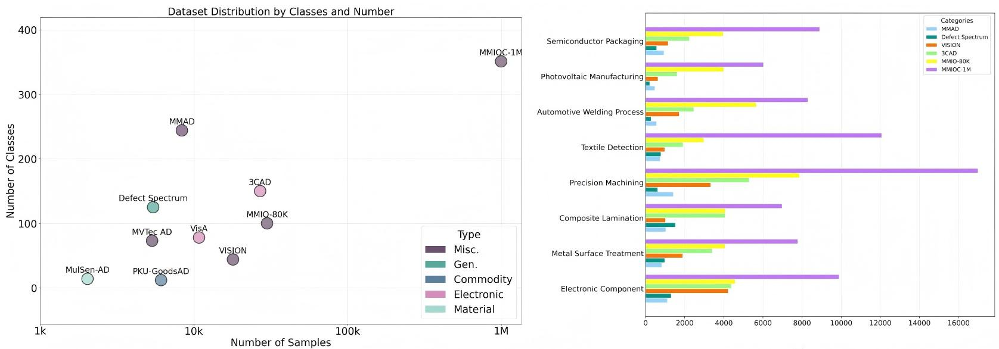
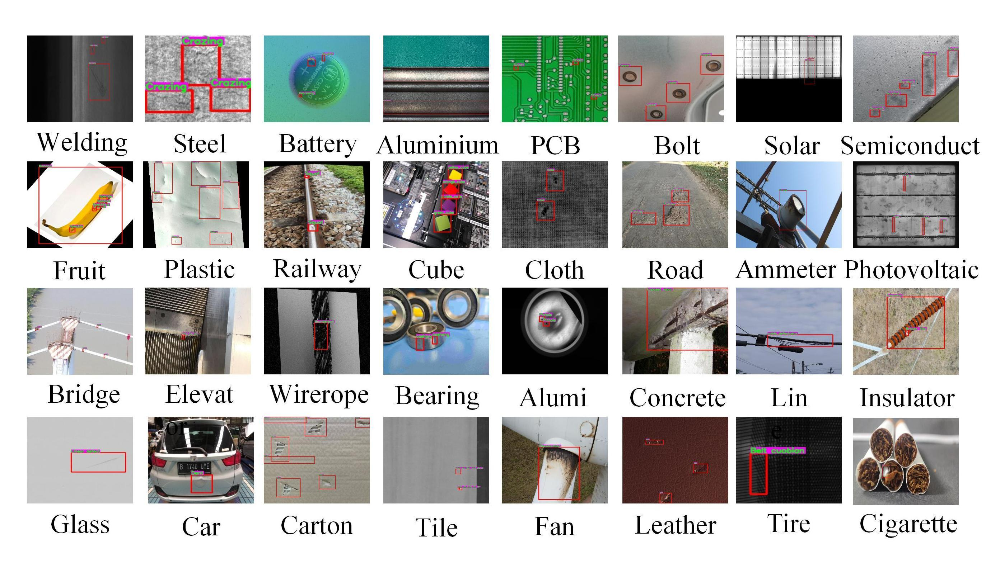
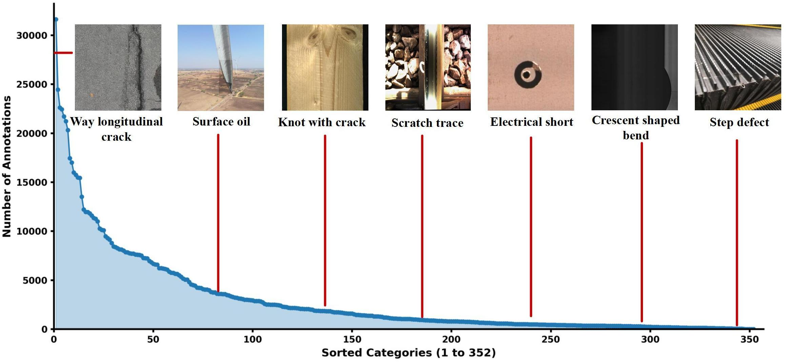

<div align="center">

# Unification of Closed–Open Industrial Detection Scenarios
### MMIOC-1M · RTVPNet

**Zekai Zhang · Jinglin Zhang · Qinghui Chen · Gang Li · Da Chen · Shuainan Jing · He Wang · Dagang Li · Cong Liu · Cong Bai · Shengyong Chen**

**IEEE Transactions on Pattern Analysis and Machine Intelligence (TPAMI), 2026**

[Paper](https://ieeexplore.ieee.org/document/11474495/) &nbsp;|&nbsp; <a href="https://huggingface.co/datasets/ZZk12138/MMIOC-1M-Curated-334"> Curated dataset</a> &nbsp;|&nbsp; [Code](#code-and-checkpoints) &nbsp;|&nbsp; [Visual examples](#visual-examples) &nbsp;|&nbsp; [Results](#results)

</div>

> **Release status:** The Hugging Face link is for the **curated 334-class train/validation subset**, whose upload is in progress. It is distinct from the paper's original 1M+ sample benchmark. The repository already contains the RTVPNet code archive and paper figures. The curated dataset link becomes public after upload verification.

## Overview

Industrial detection must handle defects across different products and manufacturing scenes while recognizing categories that may be absent from training. The [TPAMI paper](https://ieeexplore.ieee.org/document/11474495/) introduces **MMIOC-1M** for both closed-set and open-vocabulary industrial detection, together with **RTVPNet**, a model that adapts visual features to industrial domains and refines visual prompts through interaction with text.

<p align="center"><a href="datasetcompare_01.jpg"></a></p>
<p align="center"><sub>MMIOC-1M spans more samples and defect categories than the earlier datasets shown here. Open the figure to inspect the original resolution.</sub></p>

## Contributions

- **Unified benchmark:** The paper reports more than one million image-text samples and 351 defect subcategories across open and closed industrial detection tasks.
- **Refined prompting:** RTVPNet combines expert-assisted domain projection, energy-based visual prompt selection, and two-way visual-text interaction.
- **Evaluation:** Experiments cover MMIOC-1M open and closed settings, plus generalization to LVIS and COCO.

## Visual examples

<p align="center"><a href="datasetvis_01.jpg"></a></p>
<p align="center"><sub>Different product domains bring changes in texture, scale, lighting, and defect appearance. The boxes in this panel are examples from the original project figure.</sub></p>

<details>
<summary><b>Class distribution in the paper</b></summary>

<p align="center"><a href="statistic_01.jpg"></a></p>
<p align="center"><sub>The original benchmark has a long-tailed annotation distribution, so rare defects remain challenging.</sub></p>

</details>

## RTVPNet

RTVPNet first projects general visual features toward industrial domains. It then selects informative visual prompts using an energy-based score and lets visual and textual cues refine each other. The resulting features support detection, grounding, and visual question answering in the paper's framework.

<p align="center"><a href="Architect.png"></a></p>
<p align="center"><sub>Architecture from the original repository. Open the image for its full-resolution component diagrams.</sub></p>

## Results

The paper reports the following **RTVPNet** results on its original MMIOC-1M protocols. AP and AP50 are percentages; these numbers are **not** measurements of the curated Hugging Face subset.

| Model | Open AP ↑ | Open AP50 ↑ | Closed AP ↑ | Closed AP50 ↑ |
| :--- | ---: | ---: | ---: | ---: |
| RTVPNet-S | 14.9 | 26.7 | 36.7 | 60.7 |
| **RTVPNet-L** | **17.4** | **30.7** | **41.3** | **64.9** |

*Source: [paper Tables III and V](https://ieeexplore.ieee.org/document/11474495/). The open and closed columns use their respective evaluation splits.*

## Curated Hugging Face dataset

<a href="https://huggingface.co/datasets/ZZk12138/MMIOC-1M-Curated-334"> **MMIOC-1M-Curated-334 on Hugging Face**</a>

This release contains the active train and validation detection data: **382,643 images**, **942,306 COCO boxes**, and **334 active classes**. Its scope differs from the paper's original 1M+ sample benchmark. Images identified by the maintainers as having potential conflicts of interest were removed before this release, together with their linked annotations. Other annotation-quality exclusions also occurred, so the figures below are not a count of conflict-of-interest removals.

| Split | Images | COCO boxes |
| :--- | ---: | ---: |
| Train | 300,990 | 742,463 |
| Validation | 81,653 | 199,843 |
| **Total** | **382,643** | **942,306** |

The Hugging Face repository provides COCO JSON annotations, YOLO TXT labels, `leibie.txt`, and numbered image/label archives. Its [dataset card](https://huggingface.co/datasets/ZZk12138/MMIOC-1M-Curated-334) explains the archive layout and extraction steps. The link may require maintainer access until the upload is verified and made public.

## Code and checkpoints

The repository contains [RTVPNet.zip](RTVPNet.zip). Extract it with `unzip RTVPNet.zip`; the archive creates an `RTVPNet/` directory with the model code and open/closed training configurations. The training scripts and configuration files currently contain environment-specific GPU and data paths, so set those for your machine before running experiments.

The original project's separate resources remain available:

| Resource | Link | Scope |
| :--- | :--- | :--- |
| MMIOC-1M Closed data | [Baidu Netdisk](https://pan.baidu.com/s/1hW7wk6D8yJHxRxPgKcfzpg?pwd=88f5) | Legacy original release; see its access agreement |
| MMIOC-1M Open data | [Baidu Netdisk](https://pan.baidu.com/s/1CfBehOiRNVD6I8GkAje2JQ?pwd=01j5) | Legacy original release; see its access agreement |
| RTVPNet checkpoint | [Baidu Netdisk](https://pan.baidu.com/s/1t5JOE5-T5OPUWqwauZX0TQ?pwd=dn62) | Original model weights |

## Citation

```bibtex
@article{zhang2026unification,
  title={Unification of Closed-Open Industrial Detection Scenarios: New Large-Scale Benchmarks, Challenges and Baselines},
  author={Zhang, Zekai and Zhang, Jinglin and Chen, Qinghui and Li, Gang and Chen, Da and Jing, Shuainan and Wang, He and Li, Dagang and Liu, Cong and Bai, Cong and Chen, Shengyong},
  journal={IEEE Transactions on Pattern Analysis and Machine Intelligence},
  volume={48},
  number={8},
  pages={9571--9588},
  year={2026},
  doi={10.1109/TPAMI.2026.3680569}
}
```

<sub>For questions about this release, open an [issue](https://github.com/hellozzk/MMIO/issues). Related anomaly-cognition work: [MMIK-400K / ADSeeker++](https://github.com/hellozzk/MMIK-400K).</sub>
